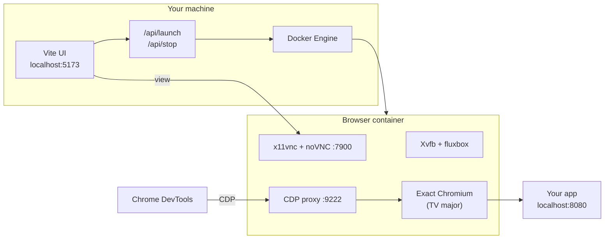

# CTV Test Kit


**Launch the exact Chromium engine that ships on a given Samsung Tizen or LG webOS TV year-model—inside Docker, in your browser, without a physical TV.**

Repository: **[github.com/SMishra25/CTV-test](https://github.com/SMishra25/CTV-test)**

---

## Why CTV Test Kit exists

CTV apps behave differently across TV generations: old Chromium builds, missing APIs, and layout quirks that desktop Chrome never shows. Testing only in the latest Chrome—or only when a dev kit is free—slows teams down and misses regressions on 2018–2022 devices.

CTV Test Kit focuses on **engine fidelity**: pick a platform and model, and run the **same major Chromium** (resolved to an exact Linux build, verified with `--version`) that those TVs use. Browsers run in **Docker** so even 2018-era engines that crash on modern macOS stay stable. You interact via **noVNC** in the UI and can attach **Chrome DevTools** to the same session when CDP is available.

---

## Key features

### Multi-platform TV profiles

- **Samsung Tizen** — year/model → Chromium major (`src/data/platforms/tizen.ts`)
- **LG webOS** — year/model → Chromium major (`src/data/platforms/webos.ts`)
- Mappings are editable when you verify `navigator.userAgent` on a physical TV

### Exact engine, no silent fallbacks

- **Chromium 53–108** — [official snapshots](https://commondatastorage.googleapis.com/chromium-browser-snapshots/) by branch base position, verified in Linux
- **Chromium 113+** — [Chrome for Testing](https://googlechromelabs.github.io/chrome-for-testing/) exact full version
- If the exact build cannot be resolved, launch **fails** (never opens a “close enough” browser)

### One-click session from the UI

- Select platform + model, optional **App URL**, then **Launch exact TV browser**
- **noVNC** embedded viewer + link to open full-screen in a new tab
- **Stop sessions** or switch models (one session at a time)

### Local app URL support

- `http://localhost:…` on your machine is rewritten to `host.docker.internal` inside the container
- Local **HTTPS / self-signed** dev servers supported for testing (dev-only certificate bypass in the TV browser)

### Debugging

- **Inspect UI (DevTools)** — desktop Chrome DevTools attached to the TV Chromium running your app (best on **113+**)
- **CDP port** exposed on localhost for advanced automation (Puppeteer/Playwright-style connect—not Cypress out of the box)

### Legacy TV support (2018)

- Separate **legacy Docker image** (Ubuntu 18.04) for Chromium **53–56** so oldest Tizen/webOS profiles start reliably

---

## Who is this for?

- **CTV / Smart TV frontend engineers** checking UI and JS compatibility per generation
- **QA** validating flows before or between real-device test passes
- **Teams** who need many Chromium majors without maintaining a farm of TVs

You still need **real TVs or a deploy tool** for final sign-off on vendor APIs, DRM, and remote interaction.

---

## High-level architecture



| Layer | Role |
|-------|------|
| `src/` + Vite | Platform/model picker, session UI |
| `server/launch-browser-plugin.ts` | Dev-only launch/stop HTTP API |
| `server/docker-launch.ts` | Ports, image choice (default vs legacy), container lifecycle |
| `docker/resolve-and-launch.mjs` | Download/cache exact binary, launch with remote debugging |
| Volume `ctv-test-kit-browsers` | Cache each exact browser download once |

---

## Getting started

1. **Install prerequisites** — Node.js 18+ (20 recommended) and **Docker Desktop** (daemon running).
2. **Clone** the repo and run `npm install`.
3. **Build Docker images** once — `npm run docker:build` (default + legacy runners).
4. **Start the UI** — `npm run dev` → open **http://localhost:5173**.
5. **Run your app** on the host (e.g. `http://localhost:8080/`).
6. Choose **platform**, **year/model**, paste **App URL**, click **Launch exact TV browser**.

```bash
git clone https://github.com/SMishra25/CTV-test.git
cd CTV-test
npm install
npm run docker:build    # ~3–5 min first time; builds both images
npm run dev
```

SSH clone:

```bash
git clone git@github.com:SMishra25/CTV-test.git
```

> **Tip:** Do not suspend the dev server with `Ctrl+Z`. If port 5173 is stuck (macOS/Linux): `lsof -ti :5173 | xargs kill`, then `npm run dev` again.

---

## Prerequisites

| Requirement | Notes |
|-------------|--------|
| **Node.js 18+** | UI and dev server |
| **Docker Desktop / Engine** | Required for every launch |
| **~6–8 GB RAM** for Docker | Recommended when downloading large browser builds |
| **Apple Silicon** | Old Linux Chromium runs under amd64 emulation; first download per version can take several minutes |

Works on **macOS**, **Windows**, and **Linux**.

You do **not** need Tizen Studio, webOS CLI, or TV SDKs to use this tool—only Docker and Node.

### Docker images (built by `npm run docker:build`)

| Image tag | Used for |
|-----------|----------|
| `ctv-test-kit-browser:latest` | Chromium **57+** (Debian Bookworm) |
| `ctv-test-kit-browser:legacy` | Chromium **53–56** (Ubuntu 18.04) |

Rebuild after changes to `docker/Dockerfile`, `docker/Dockerfile.legacy`, `docker/entrypoint.sh`, or `docker/resolve-and-launch.mjs`.

---

## Using the UI

### 1. Select platform and model

Match the **year / model** to the TV profile you care about. Each entry maps to a Chromium major in `src/data/platforms/tizen.ts` and `webos.ts`.

### 2. App URL (optional)

Default example: `http://localhost:8080/`. Examples:

```
http://localhost:8080/#/home
https://localhost:5173/
```

Start your dev server on the host first:

```bash
curl -I http://localhost:8080/
```

If the app works in normal Chrome but not in the TV browser, bind the dev server to `0.0.0.0`.

### 3. Launch and inspect

After **Launch exact TV browser**:

| Link | Purpose |
|------|---------|
| **Open viewer in a new tab** | Larger noVNC view; F11 for fullscreen |
| **Inspect UI (DevTools)** | DevTools on your machine, debugging the **TV engine** tab |

**DevTools fallback** (some legacy engines):

1. Open `chrome://inspect` in Chrome
2. **Configure** → add `localhost:<debugPort>` (shown in the UI)
3. **Inspect** under Remote Target

> Full CDP works best on Chromium **113+**. Older majors (56–108) may have limited DevTools—use noVNC for visual testing.

### 4. Stop

**Stop sessions** in the UI, or:

```bash
npm run docker:stop
```

---

## API (automation hooks)

With `npm run dev` running:

| Endpoint | Method | Purpose |
|----------|--------|---------|
| `/api/launch` | POST | JSON body: `browser.chromiumVersion`, `modelLabel`, optional `appUrl` |
| `/api/stop` | POST | Stop all labeled browser containers |

Response includes `viewUrl`, `debugPort`, and optionally `devtoolsUrl`. Connect CDP clients (e.g. Puppeteer) to `http://127.0.0.1:<debugPort>` for scripted checks on supported majors. This is **not** a Cypress integration; Cypress expects its own browser lifecycle.

---

## npm scripts

| Command | Description |
|---------|-------------|
| `npm run dev` | UI + launch API (daily use) |
| `npm run docker:build` | Build default + legacy runner images |
| `npm run docker:stop` | Stop all browser sessions |
| `npm run build` | Static UI only (no launch API) |
| `npm run preview` | Preview static build (no Docker launch) |

---

## Troubleshooting

### App shows "connection refused" in the TV browser

`localhost` inside the container is not your host. The tool rewrites to `host.docker.internal` on macOS/Windows. Confirm the app is up: `curl -I http://localhost:8080/`.

### HTTPS / certificate errors

Self-signed local HTTPS is supported for dev. Prefer plain `http://localhost:…` when possible.

### Launch fails for 2018 models (Chromium 53–56)

```bash
docker images ctv-test-kit-browser:legacy
npm run docker:build
```

### Interrupted download / cache corruption

```bash
npm run docker:stop
docker volume rm ctv-test-kit-browsers
```

Next launch re-downloads (allow several minutes on Apple Silicon).

### "Browser container exited before the session was ready"

```bash
docker ps -a --filter label=ctv-test-kit=1
docker logs <container-id>
```

Check Docker is running, increase Docker memory, or clear the browser volume (above).

### "Legacy runner image missing"

Run `npm run docker:build`.

### First launch of a new version is slow

Large downloads; **3–5 minutes** on Apple Silicon emulation is normal once per version.

### DevTools link missing

Use noVNC, or a dev overlay such as [Eruda](https://github.com/liriliri/eruda).

---

## Tuning mappings from a physical TV

1. On the TV (Developer Mode), read the Chromium major from `navigator.userAgent`.
2. Update `chromiumVersion` for that model in `src/data/platforms/tizen.ts` or `webos.ts`.
3. For majors below 113, add a base position to `SNAPSHOT_BASE_BY_MAJOR` in `docker/resolve-and-launch.mjs` if missing.

---

## Contributing

1. Fork the repository  
2. Create a feature branch  
3. Commit your changes  
4. Open a pull request  

Platform data lives under `src/data/platforms/`. Maintainer scripts under `scripts/` are optional helpers for revision lookup—not required to use the tool.
